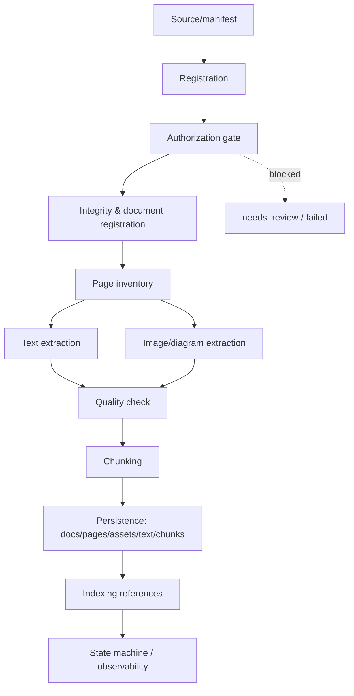

# Ingestion Architecture

## High-level architecture

## Component responsibilities

| Component | Responsibility | Classification |
|---|---|---|
| Resource discovery | Locate `manifest.yaml` or `resources/<subject>/grade<grade>/` | New design proposal |
| Manifest loader/validator | Validate R-154 required fields + schema | New design proposal |
| Source identity | Deterministic id per (checksum, edition_year, subject, grade) per R-157 | New design proposal |
| Authorization gate | Per-resource/per-operation authorization (ADR-024) | New design proposal |
| Integrity verifier | File size, SHA-256, opens, encryption, page count | New design proposal |
| Page inventory | Per-page text/image/vector/dimension profile | New design proposal |
| Native text extractor | `page.get_text("text")` equivalent | New design proposal |
| Image/diagram extractor | Method A/B/C/D metrics + asset hashing | New design proposal |
| OCR (optional, gated) | Optional, separately authorized | New design proposal |
| Chunker | Parent/child chunking with R-150 provenance | New design proposal |
| State machine | R-156 transitions | New design proposal |
| Observability/admin | Status, progress, review queue | New design proposal |
| Storage | Original PDFs, renders, assets, text, chunks, audit | New design proposal (roles) |

All components are **new design proposals**; none exist as implemented today.

## Boundaries

- **Security:** path traversal guards; size/page-count limits; MIME checks; malformed-PDF handling; untrusted document content never treated as instructions; audit logging.
- **Storage:** permanent artifacts (original PDF, page renders, assets, chunks) vs temporary processing artifacts (scratch, in-flight).
- **Async/failure:** each stage is idempotent; interruptions recover via the R-156 state machine; no long-lived DB transactions across network/provider waits.
- **Provider-agnostic:** no vendor SDK binding; PDF parsing behind an interface.

## Data flow (summary)

1. Registration validates manifest (missing/invalid → `needs_review` or `failed`; ambiguous grade/edition → explicit error, never guessed).
2. Authorization gate checks per-resource and per-operation scope; pending/denied blocks progression (never silently proceeds).
3. Integrity confirms the local file matches its registered checksum/page count; else documented mismatch.
4. Page inventory records per-page text/image/vector/dimension and classification; a page is not blank solely because native text is empty.
5. Text and image extraction run; original text kept distinct from normalized text; images retain page relationship and are deduplicated by content hash.
6. Chunking preserves semantic units (formulas, exercises, diagram relationships) and propagates R-150 provenance.
7. State machine drives `pending → processing → ready | failed | needs_review`; indexed references are only built after `ready`-eligible content.

## Storage boundaries

- Do not introduce a new DB / object storage / queue / model provider unless justified by approved architecture.
- Distinguish permanent vs temporary; original PDF remains authoritative.

## PDF adapter contract

A provider-neutral adapter is required. Currently the repository locks `pypdf` (in the `rag` extra); the historical preflight used PyMuPDF. Capabilities matrix is in `PIPELINE_STAGES.md` §Stage 3. Rendering is **not** provided by `pypdf`; the rendering capability is a design dependency requiring an explicit decision and is not treated as approved. No new dependency is selected by this design.

## Logical document-registration contract

| Concept | Definition |
|---|---|
| Source identity | Identifies the manifest/resource declaration (book code + path + subject + grade) |
| Checksum identity | PDF SHA-256; a changed PDF yields a new checksum identity |
| Document id | Per R-157: `checksum + edition_year + subject + grade` |
| Manifest metadata | R-154 fields + provenance fields |
| File integrity | size, sha256, physical page count, encryption status, original file path |
| Edition identity | `edition_year` (printing year; ADR-038) |
| Authorization reference | registry reference (e.g., `docs/licenses/13529.md`), status tracked |
| Processing state | R-156 state |
| Active extraction generation | which processing generation is currently authoritative |
| Timestamps | created_at / updated_at |
| Provenance | source_origin, publisher, book code |
| Uniqueness | unique on document id; source identity uniqueness enforced |

## Logical persistence schema (design; no SQL/ORM created)

Entities (logical; reuse existing infrastructure where possible; proposed names marked as proposals):

1. **document** — id (PK, uuid), source_identity, checksum, edition_year, subject, grade, original_filename, publisher, source_origin, authorization_ref, state, active_generation, created_at, updated_at; UNIQUE(source_identity), UNIQUE(checksum, edition_year, subject, grade).
2. **document_run** (processing generation) — id, document_id FK, generation, state, started_at, finished_at, error_code; UNIQUE(document_id, generation).
3. **document_page** — id, document_id FK, pdf_page_index_zero_based, pdf_page_number_one_based, printed_page_number (nullable), page_width, page_height, content_class, extraction_status; UNIQUE(document_id, pdf_page_number_one_based).
4. **page_extraction** — id, page_id FK, extractor_version, text_char_count, text_word_count, original_text_ref, normalized_text_ref, ocr_eligible, ocr_state.
5. **image_asset** — id, content_hash (dedupe), format, width, height, storage_ref; UNIQUE(content_hash).
6. **asset_placement** — id, asset_id FK, page_id FK, xref, occurrence_index, bbox, transform; index(page_id).
7. **extracted_text** — id, page_id FK, extraction_type (original/normalized), content, checksum; FK to page.
8. **chunk** — id (PK), document_id FK, parent_id (nullable self-FK), grade_level, subject, edition_year, chapter, page_number, chunk_index, source_type, is_valid, source_origin; UNIQUE(document_id, chunk_index); index(document_id, grade_level, subject, edition_year).
9. **chunk_parent_child** — child_id FK, parent_id FK; UNIQUE(child_id).
10. **authorization_decision** (audit) — id, resource_ref, operation, decision, reason, actor, decision_at, evidence_ref.

Page numbers: zero-based PDF index, one-based physical number, and printed page number are three distinct fields; never conflated. Printed page number is populated only when explicitly identified.

**Atomic generation replacement:** a new `document_run` becomes active generation only when its full set of chunks/assets is committed atomically; old generations remain retained for rollback/audit, and `active_generation` points to the published one. Failure rolls back entirely; no mixed old/new chunks are visible. Orphan assets are swept by content-hash dedup + FK cleanup.

## Hybrid intake (owner-confirmed)

Owner decision `hybrid_textbook_intake` (2026-11-10): support **both** controlled server-side storage registration and authenticated admin-panel upload, converging on the single shared intake/validation/authorization/ingestion pipeline.

### Intake Path A — controlled server storage

1. Authorized operator places the file in an approved controlled storage location.
2. Application discovers or registers it via an explicit administrative operation.
3. Path is resolved relative to a configured storage root; must not escape root; symlink/traversal protection is mandatory.
4. Arbitrary client-supplied filesystem paths are never accepted.
5. Validate existence, readability, type, size, SHA-256, and manifest metadata.
6. Original source files remain immutable after registration.
7. Registration produces the same normalized document intake contract as the upload path.

Distinguish **file discovery** from authorization to process: existing on the server does not authorize extraction/OCR/embedding/indexing. Do not assume `resources/` is the production storage location; follow existing storage architecture.

### Intake Path B — authenticated admin-panel upload

1. Authenticate the administrator; verify permission.
2. Accept PDF via the approved upload interface.
3. Place bytes in a restricted quarantine/temp area.
4. Verify real content and PDF signature (never trust filename/user MIME alone).
5. Enforce request-body and document-size limits.
6. Compute size and SHA-256 from actual bytes; validate the PDF.
7. Associate upload with a manifest or collect metadata via controlled workflow; preserve original bytes.
8. Promote into controlled storage only after validation; submit the same normalized intake contract.
9. Define failed-upload cleanup, duplicate-upload idempotency, retry.

### Unified intake contract

Both paths converge on the same logical intake record: `path, subject, grade, edition_year, title, publisher, license_note, original_filename, file_size_bytes, sha256, physical_pdf_pages` + provenance. Preserve mandatory R-154 fields. Distinguish intake method, original source location, controlled storage location, document identity, checksum identity. If an `intake_method` field is proposed it is **optional proposed metadata** unless a requirement makes it mandatory. Both paths invoke the same manifest validation, integrity, authorization gate, document registration, idempotency, state machine, audit. Neither bypasses ADR-024.

### Large PDF compatibility

| Setting | Current value |
|---|---:|
| API request body limit | 20 MiB |
| Nginx client body limit | 20 MiB |
| Mathematics pilot PDF | 37,478,046 bytes (~35.74 MiB) |
| Physics pilot PDF | 12,821,822 bytes (~12.23 MiB) |

The Mathematics pilot **exceeds both current 20 MiB limits**; Physics fits. This is a documented incompatibility for admin upload of the math pilot. Options (evaluated, not selected):
- Increase API/Nginx body limits to an approved value (requires Gate B; separate document-admission limit vs transport limit).
- Streaming/chunked upload if actually supported by existing infrastructure (not assumed).
- Upload into controlled storage via an approved alternative path.
- Other approaches supported by repo architecture.

Do not blindly raise 20 MiB; do not invent a max PDF size; do not assume chunked/resumable upload exists; do not equate `MAX_INGEST_PDF_BYTES` with the HTTP request-body limit. The final transport must support the verified math pilot if admin upload must cover both pilot books. Numeric values remain under owner-decision/configuration gates.

## Security defaults and R-181

- Untrusted source data: extracted text from educational PDFs is **untrusted** (R-181). It never becomes system/developer instructions and never overrides model/system policy.
- Configuration parameters (defaults require owner decision unless a requirement sets them):
  - `MAX_INGEST_PDF_BYTES` — `OWNER_DECISION_REQUIRED`
  - `MAX_INGEST_PDF_PAGES` — `OWNER_DECISION_REQUIRED`
  - allowed MIME (`application/pdf`), magic-byte verification
  - safe path resolution + traversal rejection
  - temporary storage quota / processing timeout / memory limit — `CONFIGURATION_REQUIRED`
  - decompression/malformed-PDF guards; cleanup of temporary artifacts
  - authorization check before each protected stage
  - access restriction on original files and derived assets
- Path A: configured root allowlist, safe resolution, symlink protection, least-privilege filesystem access.
- Path B: authentication, authorization, request limits, quarantine, temp quota, safe cleanup, content validation.
- Both: no client-controlled arbitrary paths; no unbounded memory/temp storage; no processing before authorization; untrusted file content cannot act as model instructions.
- Fail-closed: if any mandatory security limit is unset, processing is blocked (safe default), not unlimited.
