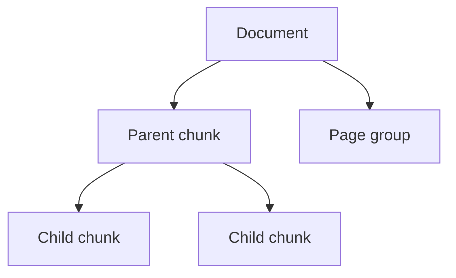

# Chunking and Provenance

## R-150 provenance fields (child chunk)

| Field | Source |
|---|---|
| `document_id` | Registered document identity |
| `grade_level` | Canonical grade (1–12) |
| `subject` | From R-151 allowlist |
| `edition_year` | Printing year (ADR-038) |
| `chapter` | From document/page structure |
| `page_number` | Physical PDF page number (one-based) |
| `chunk_index` | Stable per-document chunk ordinal |
| `source_type` | book / image / web etc. |
| `parent_id` | Parent chunk id when applicable |
| `is_valid` | Validation flag |
| `source_origin` | Source provenance |

## Hierarchy



- **Parent chunk:** surrounding context (paragraph/section/exercise).
- **Child chunk:** small retrievable unit with provenance.

## Boundary rules

- Do not split a formula, table, exercise instruction, or essential diagram relationship.
- Keep page-level context when a learning unit spans multiple pages.
- Preserve caption/heading/section structure.
- Keep image-only instructional content retrievable even when OCR yields no text.
- Never conflate PDF page index (zero-based), physical page number (one-based), and printed textbook page number.

## Citation reconstruction

Chunk metadata must allow rebuilding the citation: `[کتاب: {title} | پایه {grade} | صفحه {page} | قطعه {chunk_index}]` per existing citation contract, from the stored provenance.

## Stable identity / idempotency

- Document id per R-157: `checksum + edition_year + subject + grade`.
- Chunk id is deterministic from document id + chunk_index so re-ingestion is idempotent.

## Optional proposed fields (clear label)

Any additional fields (e.g., finer section id, learning-unit id) are **optional proposals**; they must not conflict with existing contracts.

## Illustrative chunk records — ILLUSTRATIVE — NOT PERSISTED

### Example 1 — Mathematics image-assisted instructional chunk

```yaml
parent: { document_id: "d-math-2051", chapter: "فصل ۳", section: "مثال" }
child:
  document_id: "d-math-2051"
  grade_level: 2
  subject: math
  edition_year: 1405
  chapter: "فصل ۳"
  page_number: 37          # physical PDF page number (one-based)
  chunk_index: 184
  source_type: book
  source_origin: "resources/math/grade2/C2051.pdf"
  is_valid: true
  parent_id: "p-2051-003"
  assets: [ "img-2051-xx" ]   # content-hashed asset, page 37
```
Citation: `[کتاب: ریاضی دوست‌داشتنی (۱) ... | پایه 2 | صفحه 37 | قطعه 184]` (retrieval context includes the retained illustration).

### Example 2 — Physics formula/graph-assisted explanatory chunk

```yaml
parent: { document_id: "d-phys-112209", chapter: "فصل ۳", section: "حرکت" }
child:
  document_id: "d-phys-112209"
  grade_level: 12
  subject: physics
  edition_year: 1405
  chapter: "فصل ۳"
  page_number: 16          # physical PDF page number (one-based)
  chunk_index: 31
  source_type: book
  source_origin: "resources/physics/grade12/C112209.pdf"
  is_valid: true
  parent_id: "p-112209-003"
  assets: [ "img-112209-gg" ]
```
Citation: `[کتاب: فیزیک (۳) ... | پایه 12 | صفحه 16 | قطعه 31]` (formula/graph retained as authoritative visual reference).

Both examples keep PDF page index vs physical page number vs printed page number distinct and preserve R-150 fields.
