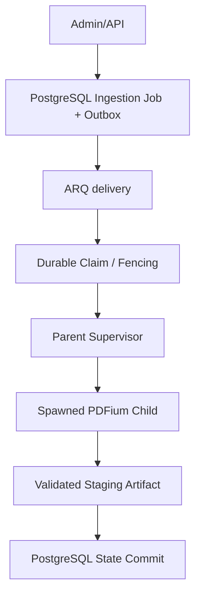

# Consolidated Owner Architecture Decision Packet — Ingestion

**Date:** 2026-11-10. Prepared for owner review; nothing is approved on the owner's behalf.

## 1. Governing documents (actual)

- `AGENTS.md`, `ROADMAP.md`, and accepted ADRs (esp. ADR-024, ADR-037, ADR-038).
- `.specify/memory/constitution.md` does **not** exist in this repo; not assumed.

## 2. Consistency review

1. Canonical document identity (R-157) is separate from provenance/authorization records — design keeps `ingestion_documents` distinct from authorization refs; dedup does not erase them. ✓
2. Request idempotency (`request_idempotency_key`+`request_hash`) is separate from document dedup. ✓
3. Transactional outbox tolerates duplicate publication via unique outbox id + deterministic ARQ job id. ✓
4. PostgreSQL claim (`FOR UPDATE SKIP LOCKED`) + `lease_token` + fencing prevent stale workers publishing. ✓
5. Job state (Queued/Running/Retry/Succeeded/Terminal/Cancelled) is independent of resource state (R-156). ✓
6. Pipeline-version reprocessing preserves prior successful artifacts (versioned staging + atomic publish). ✓
7. Cross-replica subprocess capacity is bounded (deployment decision). ✓ (parameter pending)
8. Child cancellation/termination/join/orphan recovery specified — but numeric values pending. ✓ (design)
9. DB commit + artifact publication order is recoverable (staging → validate → atomic publish → commit). ✓
10. Preserves ADR-024, R-150, R-156, R-157. ✓

Unresolved contradictions: none found; unresolved items are all **deployment/numeric** or **legal/authorization** and remain pending (not silently invented).

## 3. Target architecture

Current vs future: only the Admin/API + PostgreSQL base exist; ARQ worker exists but has no ingestion job; the rest (outbox, claim/fencing, supervisor, child, staged artifact) are **proposed**.

## 4. Owner decision table

| ID | Topic | Recommended | Reason | Alternatives | Consequences | Type | Status |
|---|---|---|---|---|---|---|---|
| A | PostgreSQL durable job + outbox | yes | DB is source of truth; reliable dispatch | Redis-only | durable/idempotent | Architecture | PENDING |
| B | At-least-once + idempotent effects | yes | no exactly-once promise; duplicate-safe | exactly-once attempt | complexity | Architecture | PENDING |
| C | Separate document identity vs provenance/auth | yes | R-157 dedup must not erase auth/provenance | embed auth in doc | risk of loss | Architecture | PENDING |
| D | Atomic claim + lease + fencing | yes | prevent stale workers | timestamps only | race risk | Architecture | PENDING |
| E | Option C bounded spawned subprocess workers | yes (candidate) | PDFium not thread-safe; crash isolation | serialized/threaded | overhead | Architecture | PENDING |
| F | Parent-only DB access | yes | child must not own DB | child writes | inconsistent state | Architecture | PENDING |
| G | Staging + validation + recoverable publication | yes | avoid corrupt/duplicate output | direct publish | partial artifacts | Architecture | PENDING |
| H | Cross-replica subprocess capacity control | deployment | avoid unbounded processes | none | resource risk | Deployment | PENDING |
| I | Retry/cancel/recovery contract | yes (design) | robust | none | complexity | Architecture | PENDING |
| J | Pipeline-version reprocessing | yes | preserve prior successes | overwrite | data loss | Architecture | PENDING |
| K | Numeric deployment settings | to be measured | never guess | fixed | mis-sizing | Deployment | PENDING |

## 5. Decision groups

- **Group 1 — Architecture (approvable conceptually):** A–G, I, J.
- **Group 2 — Deployment (pending until measured):** H + worker count, pool capacity, lease/heartbeat, job timeout, memory/CPU, retry/backoff/max attempts, recycling threshold.
- **Group 3 — Legal/Authorization (separate, pending):** pypdfium2/PDFium licensing, third-party notice obligations, PyPI provenance limitation, authorization 13529 + permitted scope, real-textbook validation approval. An architecture approval is **not** license/authorization approval.

## 6. Owner response

- `APPROVE_ARCHITECTURAL_DIRECTION`
- `APPROVE_WITH_CONDITIONS`
- `REQUEST_CHANGES`
- `REJECT`

**Owner decision: PENDING** (conceptual architecture can be approved while deployment + legal decisions stay pending).

## Owner decision — recorded (2026-11-10)

- **Decision:** `APPROVE_WITH_CONDITIONS`.
- **Exact scope:** conceptual ingestion architecture approved; runtime/deployment parameters, licensing/authorization, permitted textbook-processing operations, and Production readiness/deployment each require separate approval.
- Owner's exact wording (fa): «تأیید معماری مفهومی؛ تنظیمات اجرایی، مجوزها و Production همچنان نیازمند تأیید جداگانه باشند.»

Conditional approval applies to conceptual decision rows A–G and I–J above. Deployment rows (H) and numeric settings stay pending; legal/authorization (Group 3) and Production remain pending.

Implementation authorization (2026-11-10): owner approved the implementation specification under conditions — **only Slice 1** (durable ingestion job + outbox persistence) is authorized now; runtime/deployment parameters, licensing/authorization, and Production remain pending separate approval. Slice 1 persistence is implemented (see `DURABLE_INGESTION_JOB_IMPLEMENTATION_SPEC.md`).

## 7. Final recommendation

Approve the **architectural direction** (Group 1) as the minimum-complexity path; keep Group 2 (deployment numbers) and Group 3 (legal/authorization) pending. No additional alternatives introduced without concrete reason.

## Governance (preserved)

Gate A OPEN; pypdfium2 `OWNER_APPROVED_CONDITIONAL_CANDIDATE`; production `NOT_APPROVED`; Gate B OPEN/OWNER_DECISION_REQUIRED; Gate C OWNER_APPROVAL_REQUIRED; Phase 4 Planned/Gated; Phase 5 Not Started; concurrency_model owner_decision_pending; real-textbook validation not_run; 13529 pending_evidence_and_scope_review; manifests `needs_review`.

## Slice 2 status (2026-11-10)
- Owner approved Slice 2 (APPROVE_WITH_CONDITIONS, 2026-11-10).
- Service: ackend/app/services/ingestion_creation.py (caller-owned transaction; commit=False default).
- Idempotency scope (document_id, request_idempotency_key); equivalent returns existing job+creation outbox; conflict raises typed IdempotencyConflictError; concurrent duplicates -> one logical job/event; missing creation outbox = invariant violation.
- SLICE_2_CODE: IMPLEMENTED; SLICE_2_POSTGRESQL_VALIDATION: BLOCKED (host asyncpg connection fails; container DB healthy via SELECT 1); SLICE_2: NOT_CLOSED.
- Outbox ON DELETE CASCADE deletion/retention policy = unresolved owner decision.

### Slice 2 validation closure (2026-11-10)
- Ephemeral runner (darsyar-ai-api base + mounted backend source + uv-installed pytest/pytest-asyncio) on darsyar-ai_default network, target postgres/darsyar_test.
- SELECT current_database(), server_version() -> darsyar_test, 18.6.
- Command: pytest tests/test_ingestion_creation_db.py -q → 9 passed.
- SLICE_2_CODE: IMPLEMENTED; SLICE_2_POSTGRESQL_VALIDATION: PASSED; SLICE_2: CLOSED.

## Owner decision — Slice 3 approval (recorded 2026-11-10)

- **S-1: `APPROVE_WITH_CONDITIONS`** — authorize implementation of bounded Slice 3 (Transactional Outbox Publisher and Reconciliation).
- **S-2: `APPROVE_WITH_CONDITIONS`** — authorize publication of synthetic ingestion events to ARQ and testing actual delivery through existing Redis infrastructure.
- Boundaries (not authorized): real PDF ingestion consumer/worker; processing real textbook documents; PDFium execution; production deployment; unapproved numerical runtime settings; unapproved schema changes. Migration 0018 unchanged (R-1 RESTRICT migration not implemented).
- SLICE_3_CODE: IMPLEMENTED; SLICE_3_POSTGRESQL_VALIDATION: PASSED; SLICE_3_REDIS_ARQ_VALIDATION: PASSED (13/13 on darsyar_test + arq:queue:ingestion); SLICE_3: CLOSED.
- Runtime params (incl. batch size and scheduler cadence) remain PENDING_OWNER_APPROVAL; no automatic publisher cron registered; licensing/authorization PENDING; Production NOT_APPROVED.
