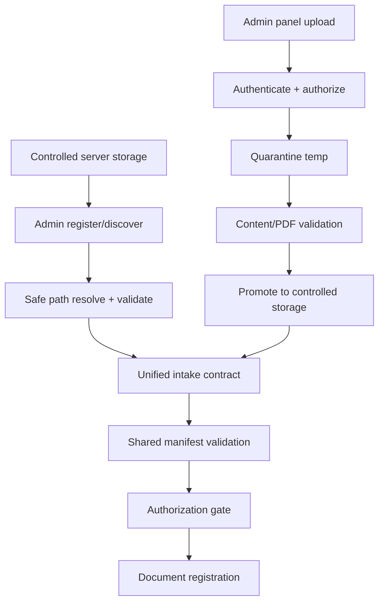

# Pipeline Stages

Each stage lists input, output, authorization check, failure behavior, and retry boundary. All stages are design proposals; none are implemented.

## Intake entry paths (owner-confirmed hybrid intake)



### Entry table

| Path | Preconditions | Inputs | Outputs | Authorization | Side effects | Failure modes | Retry | Audit |
|---|---|---|---|---|---|---|---|---|
| A: server storage | operator + explicit admin op; configured root | file path in approved root | normalized intake record | must authorize processing (discovery ≠ authorization) | immutable original; normalized record | path escape/symlink/unreadable/hash fail | re-register idempotent | register action, operator |
| B: admin upload | authenticated admin, permission | PDF bytes | normalized intake record; promoted file | required; request/document limits | quarantine, cleanup on fail, preserve original | bad signature/oversize/interrupted | safe retry; duplicate no-op | upload, quarantine, promote |

Both converge on the shared manifest validation, authorization gate, document registration, idempotency, state machine, and audit. Neither bypasses ADR-024.

## Stage 0 — Source registration

- **Input:** discovered `manifest.yaml` or `resources/<subject>/grade<grade>/<file>`.
- **Validation:** R-154 fields + schema below; R-151 subject allowlist; R-152 grade mapping (no auto legacy mapping); ADR-038 edition policy.
- **Output:** registration record, `ingestion_status: pending`.
- **Failure:** missing/invalid → `needs_review`/`failed` with code (`missing_metadata`, `invalid_subject`, `ambiguous_edition`); never guess.
- **Retry:** registration is idempotent; re-run updates rather than duplicates.

### Manifest contract (implementation-ready)

| Field | Type | Required | Validation / allowed values | Example | Failure when absent/invalid |
|---|---|---|---|---|---|
| `path` | string | yes | Path resolved safely relative to approved resource root; no traversal | `resources/math/grade2/C2051.pdf` | `missing_metadata` / path-traversal reject |
| `subject` | string | yes | exact R-151 allowlist: `math, science, physics, chemistry, biology, persian, arabic, english, quran, social_studies, religious_studies, vocation, defense` | `math` | `invalid_subject` |
| `grade` | integer | yes | canonical 1–12; reject booleans/strings | `2` | `invalid_grade` / `missing_metadata` |
| `edition_year` | integer | yes | printing/publication year (not academic year); 4-digit | `1405` | `invalid_edition_year` |
| `title` | string | yes | non-empty | `ریاضی دوست‌داشتنی (۱) ...` | `missing_metadata` |
| `publisher` | string | yes | non-empty | `شرکت افست` | `missing_metadata` |
| `license_note` | string | yes | reference to evidence/registry, never legal proof | `docs/licenses/13529.md ...` | warning (R-154) → `needs_review` |
| `book_code` | string | optional | keep as string (not arithmetic) | `"2051"` | n/a |
| `authoring_organization` | string | optional | — | `سازمان پژوهش و برنامه‌ریزی آموزشی` | n/a |
| `rights_holder` | string | optional | — | `سازمان پژوهش ...` | n/a |
| `edition_statement` | string | optional | — | `چاپ اول 1405` | n/a |
| `academic_year` | string | optional | never a substitute for `edition_year` | `1405-1406` | n/a |
| `original_filename` | string | optional | — | `C2051.pdf` | n/a |
| `file_size_bytes` | integer | optional | non-negative integer; reject bool | `37478046` | `invalid_file_size` |
| `sha256` | string | optional | 64 lowercase hex chars | `7e2c58...` | `invalid_checksum_format` |
| `physical_pdf_pages` | integer | optional | positive integer | `188` | `invalid_page_count` |
| `ingestion_status` | string | optional | R-156 states | `needs_review` | n/a |

Rules preserved:
- Canonical grade range 1–12 only; no automatic legacy mapping.
- `edition_year` is the printing year; `academic_year` is not its replacement.
- Paths are safely resolved relative to the approved resource root (no traversal).
- `sha256` must be correct hex; integer fields reject invalid values and booleans; book codes stay strings.
- `license_note` is a reference — never legal proof.

### Valid / invalid manifest examples (illustrative)

Valid (physics-pattern):
```yaml
path: resources/physics/grade12/C112209.pdf
subject: physics
grade: 12
edition_year: 1405
title: "فیزیک (۳) — پایۀ دوازدهم — رشتۀ ریاضی و فیزیک"
publisher: "شرکت چاپ و نشر کتاب‌های درسی ایران"
license_note: "owner-provided authorization reference: docs/licenses/13529.md (pending_evidence_and_scope_review)"
```

Invalid:
```yaml
# invalid: subject not in allowlist, grade out of range, edition_year is academic year
subject: literature
grade: 13
edition_year: 1405-1406
```
→ `invalid_subject`, `invalid_grade`, `invalid_edition_year` (registration fails / `needs_review`).

## Stage 1 — Authorization gate

- **Input:** registered resource + intended operations.
- **Check:** ADR-024 per-resource/per-operation authorization; distinguish owner confirmation vs registered reference vs evidence review vs scope verification.
- **Output:** allowed/denied/pending; blocked operations are recorded with a failure code and reason.
- **Failure:** pending/denied → resource stays gated; **never** represented as a successful empty extraction.
- **Application to pilots:** reference 13529 is registered but pending; do not auto-grant to books 2051/112209.

## Stage 2 — Document registration & integrity

- **Input:** authorized resource + files.
- **Checks:** file existence, open, size, SHA-256, encryption detection, physical page count, original PDF preservation.
- **Output:** document record with provenance (publisher, edition_year as printing year, book code, source origin).
- **Failure:** checksum/page mismatch → documented `failed`/`needs_review`; stop for that document.

## Stage 3 — PDF page inventory

- **Input:** registered document.
- **Output:** per-page record: `pdf_page_index_zero_based`, `pdf_page_number_one_based`, printed page number (if identified), native text char/word counts, referenced image-resource count, displayed image-occurrence count, unique image refs, vector-drawing count, page dimensions, content classification (`text_dominant/image_dominant/mixed/blank/unknown/needs_review`), extraction status, review requirement.
- **Rule:** blank is never inferred from empty native text alone.

### PDF adapter capability contract

The pipeline consumes a provider-neutral PDF adapter. Required capabilities and repository status:

| Capability | Contract | Existing `pypdf` support | Limitation / required normalization |
|---|---|---|---|
| Physical page count | exact count | `len(reader.pages)` — supported | — |
| Encryption detection | detect encrypted/password-protected | `reader.is_encrypted` — supported | — |
| Native text extraction | per-page text, documented semantics | `page.extract_text()` — supported (semantics vary) | must record extractor + version |
| Page geometry | width/height | `page.mediabox` — supported | normalize units |
| Image resources | referenced image-resource inventory | `page.images` (XObject images) — supported | maps to Method B-style resource inventory |
| Image occurrences | displayed occurrence inventory, if supported | **not directly supported** | needs placement/rendering analysis; else `UNSUPPORTED` |
| Unique image identifiers | stable backend-specific refs | xref via `page.images[i].xref` | stable per backend |
| Vector drawings | count/availability and limitations | **not directly exposed** | mark `UNSUPPORTED` unless proven |
| Page rendering | explicit capability or unsupported | **not a rendering library** | rendering capability requires a separate decision |
| Document metadata | PDF-level metadata | `reader.metadata` — supported | — |

Do not assume `pypdf` reproduces PyMuPDF metrics. See `EXTRACTION_STRATEGY.md` §Metric use and `ARCHITECTURE.md` (PDF adapter).

## Stage 4 — Text extraction

- Native extraction → quality check → reading-order validation → Persian/RTL preservation → Unicode normalization policy → original text kept distinct from search-normalized text → OCR eligibility evaluation → error handling.
- OCR is optional, separately authorized; not run on every low-text page.

## Stage 5 — Image / diagram extraction

- Extract image resources; track displayed occurrences; record XRefs; hash assets; deduplicate; keep bounding boxes and placements; associate parent page and nearby text/exercises; preserve original page renders.
- Keep the four metrics separate (resource refs, displayed occurrences, structured-text image blocks, placement rectangles) plus unique assets. **Method B** (`page.get_images(full=True)`) is the canonical metric for comparing with the historical pilot reference.

## Stage 6 — Chunking

- Build parent/child chunks; propagate R-150 provenance; avoid splitting formulas/exercises/diagram relationships; keep multi-page learning-unit context; preserve page links.

## Stage 7 — Persistence & indexing references

- Persist docs/pages/assets/text/chunks; build indexing references only after eligible content is `ready`-consistent; embeddings/indexing are out of scope for implementation now.

## Stage 8 — State machine & observability

- Drive R-156 transitions; log progress by page; surface review queue.

## Failure/retry summary

| Failure | Retryable | Behavior |
|---|---|---|
| Manifest invalid | No | `failed`/`needs_review` with code |
| Authorization pending | Manual | blocked; reason recorded |
| Checksum/page mismatch | No | `failed`; documented |
| PDF parse/encryption | No | `failed` |
| Extraction failure | Limited | retry with backoff; then `failed` |
| OCR/asset/chunk/index failure | Limited | retry bounded; then `failed` |
| Interrupted processing | Yes | recover via state machine (idempotent) |
