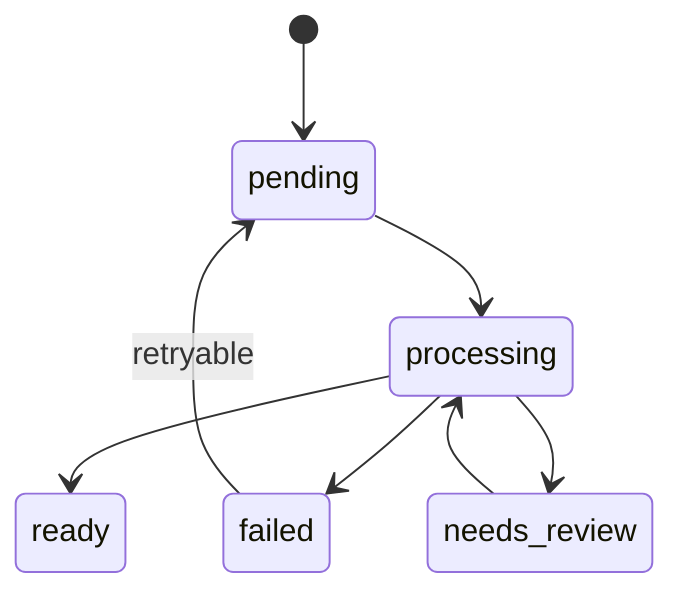

# State Machine and Failures

## R-156 state machine

Allowed transitions:
- `pending → processing`
- `processing → ready`
- `processing → failed`
- `processing → needs_review`
- `needs_review → processing` (after operator action)
- `failed → pending` (retryable only)

## Retry semantics

| Class | Retryable | Notes |
|---|---|---|
| Manifest invalid | No | `failed`/`needs_review` |
| Authorization | Manual | blocked with reason |
| Checksum/page mismatch | No | `failed` |
| PDF parse/encryption | No | `failed` |
| Extraction failure | Limited | bounded backoff |
| OCR/asset/chunk/index | Limited | bounded backoff |
| Interrupted processing | Yes | idempotent recovery |

## Machine-readable error codes

- `missing_metadata`
- `invalid_subject`
- `ambiguous_edition`
- `ocr_failed`
- `empty_extraction`
- `authorization_pending` / `authorization_denied` / `authorization_no_reference` / `authorization_evidence_missing` / `authorization_not_independently_verified`
- `pdf_open_failed`, `pdf_encrypted`, `pdf_page_count_mismatch`, `checksum_mismatch`
- `asset_extraction_failed`, `chunking_failed`, `indexing_failed`

Each code has an operator-facing message.

## Recovery after interruption

- Stage work is idempotent; re-entering `processing` resumes from recorded progress.
- No partially committed chunks remain unless committed atomically (R-157 replacement: chunk replacement is atomic).
- `needs_review` never auto-promotes to `ready`.

## Idempotency (R-157)

- Document identity: `checksum + edition_year + subject + grade`.
- First-time registration creates a new document.
- Duplicate detection by identity.
- Same-PDF reprocessing replaces previous chunks atomically (one transaction).
- Changed PDF → new checksum → new identity; never silently overwrites prior content.
- New edition → distinct identity via `edition_year`.

## Rules

- A blocked authorization decision must never be recorded as a successful empty extraction.
- No source may reach `ready` until authorization evidence/scope and `ready` acceptance criteria are satisfied.

## Concurrency and locking

Authoritative locking/uniqueness boundary: **PostgreSQL** constraints + a per-document processing lease. Queue-level deduplication is not the sole mechanism.

- **Same document, two jobs:** only one job may transition `processing`; enforced by a conditional (uniqueness) state claim on the document row. Second job sees `processing` and skips/waits.
- **Duplicate queue delivery:** idempotent claim → second delivery no-ops.
- **Worker restart / expired lease:** a lease/heartbeat on `document_run` expires; the document returns to `pending` (retryable) and can be re-claimed.
- **Stale worker fencing:** a worker publishing results must hold the current lease token; otherwise its publish is rejected (fencing). Prevent a stale worker overwriting a newer generation.
- **Reprocessing while earlier generation active:** new generation is built and committed atomically; only then `active_generation` advances. Old generation retained for rollback/audit.
- **Concurrent different editions:** distinct document ids (R-157 includes `edition_year`) → independent locks.
- **Concurrent asset extraction:** asset dedup by content hash + unique constraint; a duplicate insert returns the existing asset.
- **DB transaction boundaries:** state claim, generation commit, asset/chunk publication in one transaction per step; no long-lived transactions across provider/network waits.
- **Recovery after termination:** on restart, documents in `processing` with an expired lease are recoverable; committed generations are never partially visible.

Proposed DB lock/lease is a design proposal; it is *not* an existing implementation.
